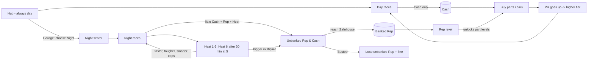

> **Status:** 🟡 Draft. Nothing here is final until marked 🟢 Locked.

# Core Loop

## The two halves
| | Day | Night |
|---|---|---|
| Where | Hub + day maps | Separate night server on a real-place map |
| Pays | **Cash only** | A little cash + **Rep** + Heat |
| Cops | None | AI cops, scale with Heat + your tier |
| Risk | None | Busted = lose unbanked Rep + fine |
| Why go | Fund parts and cars | **Rep is the only way to unlock better parts** |

Cash buys parts, but **Rep unlocks them**. So a player can't skip the cops. That's the "police required for progression" rule.

## Moment to moment (the micro-loop)
Drift / near-miss / draft / airtime → **refills nitro** + builds a **combo** → combo pays cash (day) or Rep (night) when it ends.

## Progression by stage
| Stage | Tier | What the player is doing | Gate |
|---|---|---|---|
| Early (session 1) | C | Starter car, Street parts, first day races | Street parts need no Rep |
| Early-mid (sessions 2–4) | C → B | First nights, Heat 1–2, Sport parts | **Rep 5** for Sport |
| Mid (week 1–2) | B → A → S | Second car, Race parts, Heat 3–4 | **Rep 12** for Race |
| Late (weeks 3–6) | S → SS | Pro parts, Heat 5 runs | **Rep 22** for Pro |
| End | Z | Elite parts, Heat 6 bragging rights, collection | **Rep 35** for Elite |

Numbers → [[Progression Curve]], [[Economy Settings]], [[Part Values]], [[Race Settings]], [[Heat Settings]]
